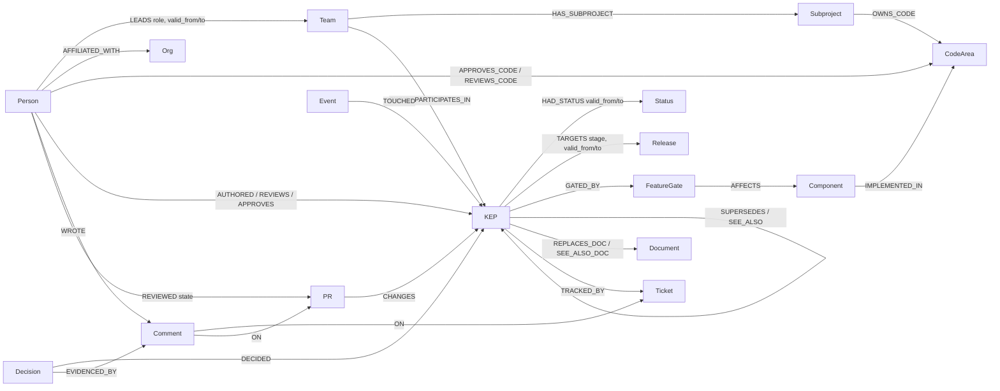

# Graph data model

Decision Brain models the Kubernetes project as a company. Teams (SIGs) own code areas and decisions (KEPs). People lead teams, approve code and write, review and approve KEPs. Every decision has a status history, release targets, the code it affects, and the tickets and chats where it was discussed.

Facts that change over time are stored as **intervals** (`valid_from`, `valid_to`, in epoch seconds, where `valid_to = null` means still true). The graph can therefore answer "now", "as of v1.29" and "what changed since" without overwriting history.

Indexes are created by [src/brain/schema.py](../src/brain/schema.py), and every demo question below is tested on a toy graph in [tests/test_schema_toy.py](../tests/test_schema_toy.py).

## Picture

## Nodes

| Label | Key | Main properties | Why it is a node | Source |
|---|---|---|---|---|
| Person | `login` (lowercase) | company | Counted, ranked (PageRank) and walked through | KEP authors/reviewers/approvers, SIG leads, OWNERS, comment authors |
| Org | `name` | | Groups people by employer | `sigs.yaml` (company) |
| Team | `id` (`sig-node`) | name, kind (sig, wg, committee), mission, url | Ownership aggregates by team | `sigs.yaml` |
| Subproject | `id` (`sig-node/kubelet`) | name, description | Bridges a team to the code it owns | `sigs.yaml` |
| CodeArea | `id` (`kubernetes/kubernetes:pkg/kubelet`) | repo, path, url, labels | "Who owns this code" is answered here | OWNERS files |
| Component | `name` (`kubelet`) | | Where a feature lands; links decisions to code | `kep.yaml` feature-gates |
| FeatureGate | `name` | | The switch a KEP adds; walks to components | `kep.yaml` |
| KEP | `id` (`KEP-753`) | number, title, status, stage, owning_sig, latest_milestone, created/updated, url, readme_url, issue_url | The unit of decision | `kep.yaml` |
| Status | `name` | | Shared target for status intervals, so "all withdrawn KEPs" is one hop | normalized status |
| Release | `version` (`v1.28`) | | Shared target for milestone intervals | `kep.yaml` milestones |
| Document | `url` | kind | Legacy design docs a KEP replaces or cites | `replaces` / `see-also` |
| Ticket | `id` (`enhancements#753`) | number, title, state, created_ts, closed_ts, url | The KEP's tracking issue (a "ticket") | GitHub issues |
| PR | `id` (`enhancements#4255`) | number, title, state, merged, url | Where KEP text changes are discussed (a "chat") | GitHub PRs |
| Comment | `id` (`comment:<gh id>`) | kind (issue, review, inline), body (2,000 chars max), at_ts, url | Evidence for decisions; signal of who knows what | GitHub comments and reviews |
| Decision | `id` (`dec:KEP-753`) | summary, rationale, alternatives, confidence, verified, stale | LLM-written rationale, always tied to evidence | Phase 5 extraction |
| Chunk | `id` | text, embedding (384-d) | Vector retrieval and the baseline | KEP READMEs, comments |
| Event | `event_id` | kind, source, occurred_at/ts, observed_at, payload | Change log; "what changed" is a graph query | git history, poller, webhook |
| Question, Draft, Watch, Meta | `id` / `key` | | Memory, action outputs, subscriptions, sync cursors | agent and real-time engine |

## Relationships

| Type | From → To | Properties | Meaning |
|---|---|---|---|
| LEADS | Person → Team | role (chair, tech_lead), valid_from, valid_to | Leadership over time (`sigs.yaml` history) |
| AFFILIATED_WITH | Person → Org | | Employer |
| HAS_SUBPROJECT | Team → Subproject | | |
| OWNS_CODE | Subproject → CodeArea | | |
| APPROVES_CODE / REVIEWS_CODE | Person → CodeArea | former (emeritus) | Code ownership |
| IMPLEMENTED_IN | Component → CodeArea | | Maps a component to its code |
| OWNS / PARTICIPATES_IN | Team → KEP | | Owning and participating SIGs |
| AUTHORED / REVIEWS / APPROVES | Person → KEP | APPROVES has valid_from, valid_to | Roles on a decision |
| HAD_STATUS | KEP → Status | valid_from, valid_to, observed_at, source_url | Status history (one open interval at a time) |
| TARGETS | KEP → Release | stage, valid_from, valid_to | Milestone plan over time |
| GATED_BY → AFFECTS | KEP → FeatureGate → Component | | What a decision affects |
| SUPERSEDES | KEP (newer) → KEP (older) | source (yaml, text, llm), verified, evidence_url | Replacement |
| SEE_ALSO | KEP → KEP | | Related decisions |
| REPLACES_DOC / SEE_ALSO_DOC | KEP → Document | | Legacy design docs |
| TRACKED_BY | KEP → Ticket | | |
| CHANGES | PR → KEP | | |
| OPENED / WROTE / ON | Person → Ticket·PR / Person → Comment / Comment → Ticket·PR | | Discussion |
| REVIEWED | Person → PR | state, at | Formal review |
| DECIDED / EVIDENCED_BY | Decision → KEP / Decision → Comment | | Rationale and its evidence |
| TOUCHED | Event → entity | | What a change affected |
| REVIEWED_FOR | Person → Person | weight | Derived reviewer-to-author edge for PageRank |

## Rules
- **Direction**: from actor to thing, and from newer to older (`SUPERSEDES`).
- **Node or property**: a node when it has identity and is counted, ranked or walked through (Status, Release, Component, Org). A property otherwise (title, stage).
- **Process labels** (`lgtm`, `approved`, `size/*`, `kind/*`, `needs-*`) are not topics. They stay properties of tickets and PRs.
- **IDs**: `KEP-<n>`, team folder name, lowercase login, `org/repo:path` for code. Every write `MERGE`s on these keys, so loading is idempotent.

## Demo questions as paths (tested in `tests/test_schema_toy.py`)

| # | Question | Path |
|---|---|---|
| 1 | Who owns the kubelet? | Component → IMPLEMENTED_IN → CodeArea ← OWNS_CODE ← Subproject ← HAS_SUBPROJECT ← Team; Person → APPROVES_CODE → CodeArea |
| 2 | Who knows most about sidecars? | full-text KEP ← AUTHORED / APPROVES / REVIEWS ← Person (plus WROTE → Comment → ON → Ticket ← TRACKED_BY ← KEP) |
| 3 | Why was KEP-3063 withdrawn, and what replaced it? | KEP → HAD_STATUS (open) → Status; KEP ← SUPERSEDES ← KEP; Decision → EVIDENCED_BY → Comment |
| 4 | What was KEP-753's status in late 2023? | KEP → HAD_STATUS where valid_from ≤ t < valid_to |
| 5 | What does KEP-753 affect, and who must know? | KEP → GATED_BY → FeatureGate → AFFECTS → Component → IMPLEMENTED_IN → CodeArea ← APPROVES_CODE ← Person; KEP ← SEE_ALSO ← KEP |
| 6 | Who leads sig-node now, and who did then? | Person → LEADS (interval at t) → Team |
| 7 | What changed in sig-node since a date? | Event → TOUCHED → KEP ← OWNS ← Team, filtered by occurred_ts |
| 8 | Which releases does KEP-753 target? | KEP → TARGETS (open) → Release |
| 9 | Where is the evidence, and who said it? | KEP → TRACKED_BY → Ticket ← ON ← Comment ← WROTE ← Person |
| 10 | How is a person connected to a KEP? | `algo.SPpaths` with `relDirection: 'both'`, maxLen 4 |

## FalkorDB specifics found while testing
- Re-creating an index fails with "already indexed". `schema.py` treats that as success.
- Full-text search supports prefixes (`sidec*`) and fuzzy matching (`%sidcar%`).
- `shortestPath` is directed-only and only allowed in `WITH` or `RETURN`. Use `algo.SPpaths({..., relDirection:'both'})` for undirected paths.
- Vector `score` is a distance (lower means closer).
